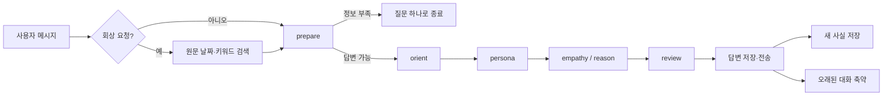

<h1 align="center">$\bf{\large{\color{#6580DD} 내 친구 민수 }}$</h1>

**앞 대화까지 읽고, 공감할지 방법을 같이 찾을지 정해서 답하는 감정 대화 서비스입니다.**

서비스 이름은 `내 친구 민수`, 대화 캐릭터는 `스트롱 민수`입니다. 하루를 정리하지 못한 채로 적은 말을 그대로 받고, 더 들어야 답할 수 있으면 질문 하나를 먼저 합니다. 사용자가 직접 말한 사실은 기억 그래프로 저장하고 화면에서 보고 고칠 수 있습니다.

<hr>

## 개발 환경

### Language


### Backend & Agent


### Frontend


### Database


### AI & Model


### Infra


<hr>

## 주요 기능

### 1. 답하기 전에 더 물을지 판단
- 바로 답하기 어려운 메시지에는 질문 하나만 하고 턴을 끝냅니다.
- 답할 수 있으면 앞 대화를 읽고 감정을 풀어놓는 중인지, 방법을 찾는 중인지, 마무리하는 중인지 `Arc`에 기록합니다.
- 앞에서 이미 한 질문이나 제안은 `Arc`를 보고 반복하지 않습니다.

### 2. 공감과 방법 제안을 나눠서 생성
- 공감 답변과 방법 제안을 따로 만들고, 둘 다 필요하면 공감 뒤에 방법을 붙입니다.
- 말투와 피해야 할 표현(Persona)은 4턴 동안 재사용하고, 방향 전환이나 위기 신호가 있으면 바로 갱신합니다.
- 보내기 전에 초안을 한 번 검수하고 문제가 있는 부분만 고칩니다.

### 3. 사용자가 확인하는 기억
- 사용자가 직접 말한 사실만 `Entity → Statement → Entity` 구조로 Neo4j에 저장하고, 모델의 추측은 따로 보관합니다.
- 기억 그래프에서 노드를 눌러 내용 수정, 공개 범위 변경, 삭제를 할 수 있습니다. 삭제한 기억은 모델에 보내지 않습니다.
- `quiet` 기억은 사용자가 같은 이야기를 다시 꺼낼 때만, `proactive` 기억은 첫 인사나 답변에서 먼저 사용합니다.

### 4. 예전 대화 회상
- "전에 말했잖아"처럼 확인을 요구하면 LLM 대신 날짜와 키워드로 대화 원문을 검색합니다.
- 검색 결과가 없으면 기억하는 척하지 않습니다.
- 가입 이후 대화 원문은 PostgreSQL에 보관하고, 모델이 읽는 작업 문맥만 축약합니다.

### 5. 위기 신호 대응
- 자해, 극단 선택, 폭력 관련 표현을 띄어쓰기와 관계없이 감지합니다.
- 위기 신호가 있으면 109, 1577-0199, 1366 등 24시간 상담 전화를 안내하고, 검수 단계에서도 이 안내를 지우지 않습니다.
- 대화를 축약할 때도 위기 관련 문장은 남깁니다.

### 6. 기다림과 접근 관리
- 답변은 비동기 작업으로 처리하고, 화면에서 진행 단계를 보여주며 중간에 취소할 수 있습니다.
- 채팅창을 처음 열면 마지막 대화 시각과 먼저 말해도 되는 기억을 보고 첫 인사를 만듭니다.
- 초대 코드가 있어야 가입할 수 있고, 로그인 실패가 반복되면 시도를 제한합니다.

<hr>

## 아키텍처



| 단계 | 하는 일 |
| --- | --- |
| `opening` | 마지막 대화 시각과 이전 기록을 보고 첫 인사 생성 |
| `prepare` | 바로 답할지, 질문을 먼저 할지 결정하고 위기 표현 확인 |
| `orient` | 대화 흐름을 `Arc`에 기록하고 답변 종류 결정 |
| `persona` | 말투와 피할 표현을 정하고 4턴간 재사용 |
| `empathy` / `reason` | 공감 답변과 방법 제안을 각각 생성 |
| `review` | 초안을 한 번 검수하고 필요한 부분만 수정 |

답을 보낸 뒤 기억 저장과 대화 축약을 동시에 시작해서, 기억 처리 때문에 응답이 늦어지지 않게 했습니다.

| 기술 | 맡은 일 |
| --- | --- |
| React + TypeScript | 채팅방, 기억 그래프, 답변 진행 상태 확인과 취소 |
| FastAPI + asyncio | 로그인, 답변 작업 시작, 진행 상태 조회, 취소 |
| LangGraph + LangChain Core | 단계별 대화 그래프, 기억 검색, 대화 축약 |
| Neo4j | 사용자가 말한 사실과 수정·삭제 상태 |
| PostgreSQL | 사용자, 로그인 토큰, 모델 설정, 대화 원문 |
| Docker Compose + nginx | Neo4j, PostgreSQL, 프론트엔드 실행과 `/api` 프록시 |
| [AlgoceanCodexOAuth](https://github.com/algocean1204/AlgoceanCodexOAuth) | 로컬에서는 Codex OAuth로, 서버에서는 API 키로 모델 호출 |

```text
app/
├── auth/        # 가입, 로그인, 시도 제한
├── graph/       # 대화 그래프와 단계별 서브그래프
├── llm/         # 모델 목록과 Codex·Claude 연결
├── session/     # 세션, 기억 선택, 대화 축약
├── main.py      # FastAPI 엔드포인트와 답변 작업 실행
└── opening.py   # 첫 인사 생성
frontend/        # React 화면과 nginx 설정
ontology/        # Neo4j 스키마
postgres/        # 사용자 DB 스키마
tests/           # 그래프, API, 기억, 보안 테스트
```

<hr>

## 설치 및 실행

Python 3.12 이상, [uv](https://docs.astral.sh/uv/), Docker가 필요합니다. 로컬에서는 Codex CLI 로그인으로 모델을 호출하고, API 키를 넣으면 API 키 모드로 동작합니다.

```bash
cp env.example .env                 # DB 비밀번호, 초대 코드 등 입력
codex login
uv sync

docker compose up -d db users       # Neo4j, PostgreSQL
HEALER_HOST=0.0.0.0 uv run healer run
./scripts/docker-web.sh             # 프론트엔드 빌드 후 http://127.0.0.1:8080
```

### 테스트

```bash
docker compose up -d db users
uv run pytest -q
uvx pyright app tests

cd frontend
npm run typecheck
npm run lint
npm run build
```

<hr>

## 라이선스

[Apache License 2.0](LICENSE)
