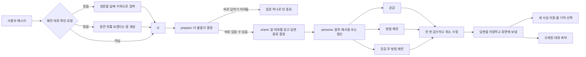

# 내 친구 민수

앞 대화까지 읽고, 공감할지 방법을 같이 찾을지 정해 답하는 AI.

서비스 이름은 `내 친구 민수`, 대화 캐릭터는 `스트롱 민수`다.

## 왜 만들었나

하루가 끝난 뒤에는 무슨 일이 있었고 왜 힘든지 정리해서 말하기 어렵다. 이때 완성된 질문부터 요구하거나 바로 해결책을 주면 대화를 시작하기가 더 힘들어진다.

민수는 정리되지 않은 말부터 받는다. 더 알아야 답할 수 있으면 질문 하나를 하고, 이미 충분히 들었다면 공감하거나 방법을 함께 찾는다.

## 모델에 연결만 한 채팅과 다른 점

| 모델에 연결만 한 채팅 | 내 친구 민수 |
| --- | --- |
| 지금 받은 메시지를 바로 모델에 보냄 | 하나의 채팅방에서 최근 흐름과 관련 기억을 함께 읽음 |
| 한 번에 답변을 만듦 | 더 물을지 먼저 정하고 공감과 방법을 따로 만듦 |
| 대화 전체를 한 덩어리로 요약 | 사용자가 직접 말한 사실만 골라 저장 |
| 저장된 기억을 사용자가 확인하기 어려움 | 기억을 화면에서 보고 수정하거나 삭제 가능 |
| 만든 답변을 바로 전송 | 초안을 한 번 검수하고 필요한 부분만 고쳐 전송 |

## 메시지가 답이 되기까지



채팅창을 처음 열 때는 가짜 사용자 메시지를 넣지 않는다. 실제 마지막 대화 시각, 사용자 시간대, 먼저 말해도 되는 기억을 보고 첫 인사를 만든다.

2026-08-07 로컬 실측에서 Persona를 갱신한 전체 턴은 47.283~60.250초, 직전 Persona를
재사용한 다음 턴은 40.609~41.510초였다. 변경 전 전체 평균 80.8초보다 25.4~49.7% 짧다.

## 대화 로직

| 단계 | 하는 일 |
| --- | --- |
| `opening` | 마지막 대화 시각과 이전 기록을 보고 첫 인사를 만듦 |
| `prepare` | 바로 답할지, 질문 하나를 먼저 할지 결정하고 자해·극단 선택 표현이 있는지 확인 |
| `orient` | 감정을 풀어놓는 중인지, 방법을 찾는 중인지, 대화를 마무리하는 중인지 `Arc`에 기록. 낮은 강도의 직접 조언 질문은 방법 경로 하나로 답함 |
| `persona` | 말투와 피해야 할 표현을 정하고 4턴간 재사용. 방향 전환·위기·거절·새 경계에서는 즉시 갱신 |
| `empathy` / `reason` | 공감 답변과 방법 제안을 따로 만들고, 둘 다 필요하면 공감 문장 뒤에 방법을 붙임 |
| `review` | 초안을 한 번만 읽고 문제가 있는 부분만 고침. 위기 안내와 코드 안전선은 그대로 유지 |

회상 요청에서는 원문 검색과 확인 문장을 동시에 처리한다. 답을 보낸 뒤에는 기억 처리와 대화
압축을 동시에 시작하되 서로 다른 세션 필드만 저장한다. 질문 필요 여부와 감정 분석을 나눈
병렬 후보는 48개 비교에서 품질 0/48 일치, P50 9.969→10.885초로 더 느려 운영에서 제외했다.
실제 웹 12개 연속 흐름에서는 회상 오탐·회상 질문의 근거 혼입·위기 역할 설명을 찾아 고친 뒤
모두 다시 통과했다. 브라우저 관측 평균은 57.788초, 범위는 15.145~95.783초였다.

## 이렇게 나눈 이유

| 선택 | 이유 |
| --- | --- |
| 답변마다 `Arc` 저장 | 앞에서 이미 한 질문이나 제안을 반복하지 않기 위해 |
| 공감과 방법 제안 분리 | 위로가 필요한 사람에게 바로 체크리스트를 주지 않기 위해 |
| Persona 4턴 임대 | 친구의 말투가 매번 바뀌는 어색함과 불필요한 호출을 함께 줄이기 위해 |
| 검수와 수정을 한 번에 처리 | 반복해서 고치다가 원래 답을 잃지 않고 기다림을 줄이기 위해 |
| 답변을 보낸 뒤 기억 정리 | 기억 저장 때문에 사용자가 더 오래 기다리지 않게 하기 위해 |

## 기억 로직

- 가입 이후 대화 원문은 PostgreSQL에 그대로 보관하고, AI가 읽는 작업 문맥만 줄임
- 사용자가 직접 말한 사실만 `Entity → Statement → Entity` 구조로 저장
- 확인된 사실과 모델의 추측을 따로 보관
- `quiet` 기억은 사용자가 같은 이야기를 다시 꺼냈을 때만 사용
- `proactive` 기억은 사용자가 먼저 말하지 않아도 첫 인사나 답변에서 사용 가능
- 사용자가 지운 기억은 모델에 보내지 않음
- 민감한 기억은 원문을 보내지 않고, 위기 여부를 확인할 신호만 사용
- 자해·극단 선택과 관련된 문장, 최근 대화, 질문과 답의 순서는 대화를 줄일 때도 남김
- 현재 메시지와 연결된 기억만 찾아 답변에 넣음
- “전에 말했잖아”처럼 확인을 요구하면 LLM 대신 날짜·키워드 검색으로 원문을 찾음
- 검색 결과가 없으면 기억하는 척하지 않음


## 기술 구성

| 기술 | 맡은 일 |
| --- | --- |
| React + TypeScript | 하나의 채팅방, 기억 그래프, 답변 진행 상태 확인·취소 |
| FastAPI + asyncio | 로그인, 답변 작업 시작, 진행 상태 조회, 취소 |
| LangGraph + LangChain Core | 더 물을지 결정, 공감·방법 선택, 답변 최소 수정, 기억 검색, 오래된 대화 축약 |
| Neo4j | 사용자가 말한 사실과 수정·삭제 상태를 연결해 저장 |
| PostgreSQL | 사용자, 로그인 토큰, 모델 설정, 가입 이후 대화 원문 |
| JSON session store | AI가 읽는 작업 문맥, 직전 답변 종류, 확인 전 추측 |
| Docker Compose + nginx | Neo4j, PostgreSQL, 프론트엔드 실행과 `/api` 프록시 |
| [AlgoceanCodexOAuth](https://github.com/algocean1204/AlgoceanCodexOAuth) | 로컬에서는 Codex OAuth로, 서버에서는 API 키로 모델 호출 |

## 프로젝트 구조

```text
app/
├── auth/                 # 사용자 인증과 요청 제한
├── graph/                # 대화 그래프와 답변 검사
├── llm/                  # 모델 목록과 인증 방식 연결
├── session/              # 세션, 기억 선택, 대화 축약
├── main.py               # FastAPI와 답변 작업 실행
└── opening.py            # 첫 인사 만들기
frontend/                 # React 화면과 nginx 설정
ontology/                 # Neo4j 스키마
postgres/                 # 사용자 DB 스키마
tests/                    # 그래프, API, 기억, 보안 검증
```

## 실행

```bash
cp env.example .env                 # 환경변수 설정
codex login                         # 로컬 OAuth 로그인
uv sync

docker compose up -d db users       # Neo4j와 PostgreSQL 실행
HEALER_HOST=0.0.0.0 uv run healer run
./scripts/docker-web.sh             # 프론트엔드 빌드·실행
```


## 테스트

```bash
docker compose up -d db users
uv run pytest -q
uvx pyright app tests

cd frontend
npm run typecheck
npm run lint
npm run build
```
